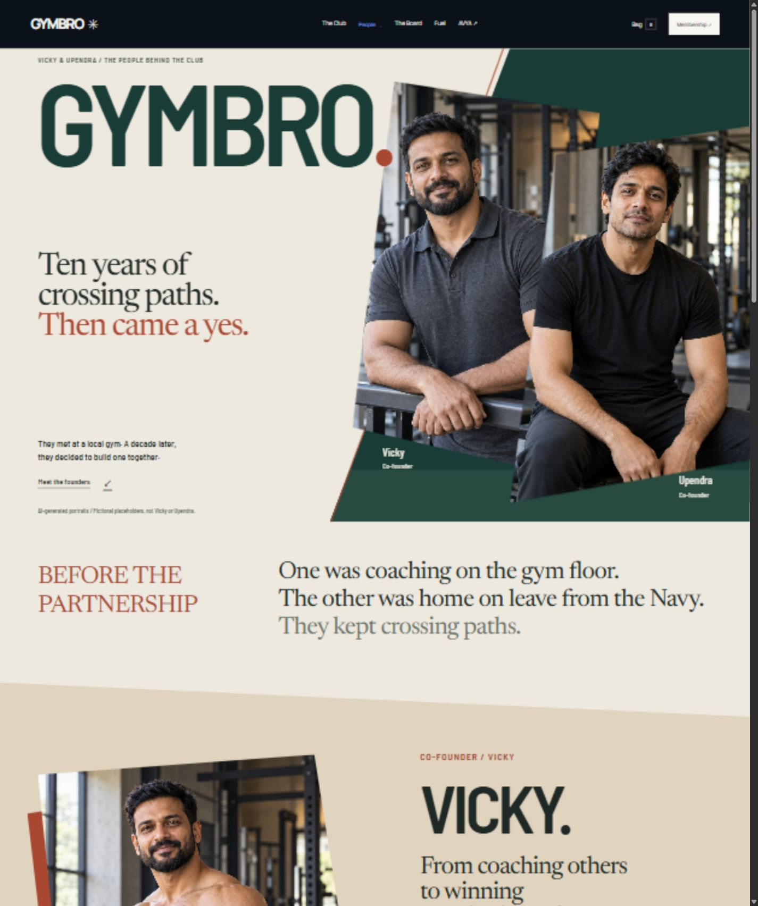

# GYMBRO — interactive concept preview

**Website:** [upendraprasad19.github.io/Gymbro](https://upendraprasad19.github.io/Gymbro/)

**Repository:** [upendraprasad19/Gymbro](https://github.com/upendraprasad19/Gymbro)

This repository contains the eight-page GYMBRO concept website. GitHub Pages publishes the generated `dist/` directory when changes reach `main`; pull requests run the website checks before merging.

## Local development

Run `npm ci`, `npm run bundle`, `npm run build`, `npm test`, then `npm run preview`. Open `http://127.0.0.1:4173/Gymbro/`. The generator writes complete HTML pages into `dist/`, which can then be served by any static host without a runtime framework. Edit `site/` for page content and shared layout; edit `dist/styles.css`, `dist/app.js` and the Board/staff modules for styling and interactions. Do not hand-edit generated HTML.

Pages: Home, The Club, Our Story, Coaches, The Board, Membership, Fuel and AVYA, plus staff access for the separately configured record service. Vicky and Upendra receive equal founder prominence; Rohit, Sameer and Amit appear as coaches. Founder biographies use the owner's supplied account. Generated portraits and athletic/service scenes are visibly labelled fictional; coach profile copy and Board results remain samples. AVYA actions link to its live web app at https://app.icanbefitter.com.

Interactions include keyboard-accessible training tabs, membership selection, supplement filters/details, quantities and a page-local demo bag, checkout explanation, trial validation, responsive navigation, modal focus restoration and reduced motion. The Board supports separate events/divisions, ties, history and truthful empty/error states.

Training/product photos are AI concept imagery. Prices remain unconfirmed samples. Bookings, orders and payments are demonstrations and do not transmit form details. AVYA is an independent live app; no shared login or membership bundle is implied.

## Record workflow

The migration and staff UI implement coach submissions, private evidence, owner approval, corrections, rejection and withdrawal. The public service configuration is empty: no hosted project or staff accounts have been created. Embedded PostgreSQL tests verify the SQL rules against synthetic auth/storage schemas. Full Supabase Auth/REST/Storage integration is a separate test and remains unverified because the local Docker engine was unavailable.

For a populated design review, `dist/visual-preview.js` enables fictional Board records and member portraits from `dist/sample-board.mjs`. These are never sent to the record service. Once real service credentials are configured, the Board loads real approved data and does not mix in the samples. Turn the visual-preview switch off to restore the unconfigured empty state. See [portrait prompts and asset paths](docs/sample-image-prompts.md).

See [activation instructions](docs/record-workflow-setup.md). A dedicated service needs separate authorization and actual staff email addresses; do not reuse AVYA's backend. `npm run test:workflow` runs only against a running local Supabase stack and refuses remote URLs. No test credentials are written to files.

## Art direction

- Graphite, warm off-white and cobalt; Manrope with IBM Plex Mono.
- Full-bleed deadlift hero with oversized GYMBRO typography.
- Asymmetric editorial sections and sparse technical details.
- Entrance animation, scroll reveals, photographic depth and precise hover transitions; reduced motion disables these effects.
- Our Story has its own diagonal composition, shaped crops, Barlow Semi Condensed/Newsreader typography and a navy service chapter. Edit `site/story-content.html` and `dist/story.css`; its styles are isolated from other pages.

## Assets

- Hero, training and product photographs: generated with the built-in image generation tool for this preview, then JPEG-encoded for faster loading without cropping or retouching. Prompt briefs: industrial athletic photographs of a deadlift, ring support, heavy-bag boxing and sled push; neutral seamless product photographs with restrained cobalt accents, exact category names and explicit CONCEPT markings. No health or authenticity claims appear on the packaging.
- Arena photograph: exported unchanged from the user-supplied HTML prototype; confirmed by the user as a sample AI image.
- Font files and their licenses: Manrope and IBM Plex Mono, obtained from Google Fonts.
- Founder-story fonts and OFL licenses: Barlow Semi Condensed and Newsreader. Founder athletic/service concepts and their prompts: [bodybuilding](docs/bodybuilding-concept-prompt.md), [naval service](docs/naval-service-concept-prompt.md).

## Publication

The public GitHub repository is named **Gymbro**. GitHub Pages publishes only `dist/` through `.github/workflows/pages.yml`. The updated workflow installs pinned dependencies, builds and tests before publishing when source/site/test changes reach main. Documentation-only changes do not trigger publication. The workflow can also be run manually. No commit, push or deployment is permitted without explicit user instruction.

Local Sites configuration and the convenience ZIP archive are excluded from Git. No account tokens, credentials or environment files belong in this repository.

## Preview

